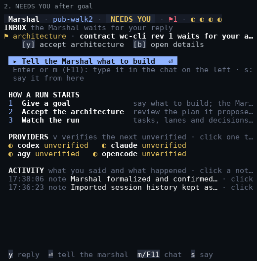
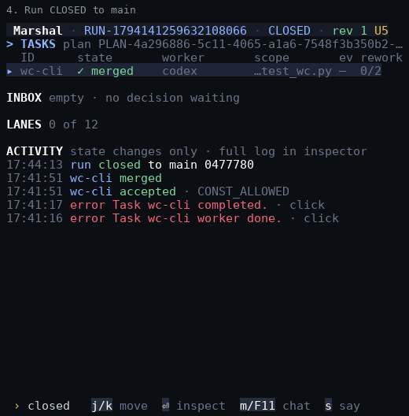

<div align="center">

# Marshal

### Plan with one AI. Let other AIs build it. Stay in charge.

**A free, open-source multi-agent coding orchestrator for your terminal.
Claude Code, Codex, OpenCode and Antigravity work together on your project:
one plans, others build, a different one reviews, and verified work lands on `main`.**

[](https://github.com/Zen1th53/marshal/actions/workflows/ci.yml)
[](https://github.com/Zen1th53/marshal/releases)
[](https://go.dev)
[](LICENSE)
[](#1-install-marshal)
[](https://github.com/Zen1th53/marshal/stargazers)

```bash
curl -fsSL https://raw.githubusercontent.com/Zen1th53/marshal/main/install.sh | sh
```

[Quick start](#60-second-quick-start) ·
[The Board](#the-board-and-core-shortcuts) ·
[Providers](#supported-providers) ·
[Telemetry](#telemetry-and-privacy) ·
[Docs](#documentation)

<br>


&nbsp;


</div>

---

**Current release: `v0.2.0`**

Marshal is a free, open-source (AGPL-3.0 plus a commercial licence) local multi-agent coding orchestrator. Plan work with one AI, let other AI agents do it, and stay in charge.

Instead of typing a request into one AI assistant and hoping for the best, Marshal coordinates a structured multi-agent workflow on your machine:
- One AI acts as the **Marshal**: it talks through your goals, clarifies decisions, drafts architecture, and decomposes work into small, verifiable tasks.
- Dedicated **Worker Agents** (Claude Code, OpenAI Codex, OpenCode, and Antigravity) implement each task in its own isolated Git worktree.
- A **Cross-Provider Reviewer** inspects every completed task against acceptance criteria, ensuring no model grades its own work.
- An **Independent Verifier** executes test suites and acceptance checks before changes are merged.
- Verified results are cleanly merged and **closed to main**.

> [!WARNING]
> **Host Execution Notice**: Workers run directly on your host machine under your local user account without a sandbox. Worktrees isolate Git changes, not system calls or process execution. Always review goals, plans, and code before approving execution.

---

## 60-Second Quick Start

### 1. Install Marshal

Install the latest binary release for Linux (amd64 or arm64):

```bash
curl -fsSL https://raw.githubusercontent.com/Zen1th53/marshal/main/install.sh | sh
```

By default, the binary is placed in `~/.local/bin/marshal`. Make sure `~/.local/bin` is on your `$PATH`.

Alternatively, build from source using Go:

```bash
git clone https://github.com/Zen1th53/marshal.git
cd marshal
go build -o marshal ./cmd/marshal
install -Dm755 marshal ~/.local/bin/marshal
```

Verify the installation:

```bash
marshal version
marshal doctor
```

### 2. Initialize your project

Enter an existing Git repository and run `marshal init`:

```bash
cd /path/to/your/project
marshal init
```

`marshal init` writes default metadata (`CAPABILITIES.yaml`, `PACK-VERSION.yaml`, `RUNTIME-VERSION.yaml`), initializes the `.marshal/` state directory, and excludes `.marshal/` from Git tracking via `.git/info/exclude`.

### 3. Launch the Board

Start the interactive terminal environment:

```bash
marshal
```

Marshal opens inside a tmux session displaying **the Board**: a live command center showing your tasks, worker lanes, activity log, and docked chat pane.

### 4. Direct your first run

1. **State your goal**: Press `s` on the Board to open the composer, or switch focus to the chat pane with `F11` (or `Alt+←`), and describe what you want built.
2. **Accept the architecture**: The Marshal clarifies requirements and drafts a project contract. When the header displays `NEEDS YOU`, press `y` to accept the architecture.
3. **Approve the plan**: The Marshal produces a plan of discrete tasks with check criteria. Press `y` to approve the plan.
4. **Watch workers execute**: Worker agents run tasks across isolated branches. Diff review and independent verification run automatically.
5. **Close to main**: Once verification passes, changes are merged cleanly into your `main` branch.

---

## The Board and Core Shortcuts

The interactive Board uses tmux to manage panes and terminal sessions:

| Key | Action |
|---|---|
| `F11` | Toggle focus between the Board and the docked Marshal chat pane |
| `Alt+←` / `Alt+→` | Switch focus left to the chat or right to the Board |
| `s` | Say something to the Marshal (opens composer from any view) |
| `v` | Verify providers (arms verification on first-use card or in Providers view) |
| `y` | Arm confirmation for pending `NEEDS YOU` gates (architecture or plan approval) |
| `Enter` | Inspect a highlighted task; on a lane, open its worker session |
| `Esc` | Close the inspector, return from any view, or dismiss help |
| `1` .. `8` | Switch views: `1` Board, `2` Host, `3` Memory, `4` Providers, `5` Verify, `7` Plan, `8` Architecture |
| `Ctrl+P` | Open command palette |
| `Ctrl+X` | Stop all running workers (never stops the Marshal) |
| `?` | Show complete keyboard help |

When inspecting a task with `Enter`, the **Inspector Action Row** offers contextual actions:
- `[a]` approve / `[A]` approve-all
- `[d]` deny
- `[r]` return for rework
- `[x]` cancel task
- `[o]` open worker pane

---

## Supported Providers

Marshal supports four runtime providers out of the box:
- **Anthropic Claude Code** (`claude`)
- **OpenAI Codex** (`codex`)
- **OpenCode** (`opencode`)
- **Google Antigravity** (`agy` / `antigravity`)

Install the provider CLIs you intend to use and log in through their native authentication commands. Run `v` on the Board or `marshal doctor --probe-providers` in your terminal to verify harness health.

---

## Telemetry and Privacy

Marshal includes anonymous, opt-out telemetry sent to `https://marshal.blackhat.uz`. Telemetry reports a random installation ID, public key, version, OS/architecture, active mode, and timestamps.

Marshal **never** transmits project code, prompts, git histories, file paths, commands, or free text.

To inspect or disable telemetry:

```bash
# Check status
marshal telemetry status

# Opt out via CLI
marshal telemetry disable

# Or opt out via environment variable
export MARSHAL_CLOUD_ENDPOINT=off
```

---

## Documentation

Full documentation is available in the `docs/` directory:

- [Installation](docs/installation.md)
- [Getting Started](docs/getting-started.md)
- [The Board and Keys](docs/board-and-keys.md)
- [Providers & Harnesses](docs/providers.md)
- [How a Run Works](docs/how-it-works.md)
- [Memory & MCP](docs/memory-and-mcp.md)
- [Configuration & Settings](docs/configuration.md)
- [Telemetry](docs/telemetry.md)
- [Troubleshooting](docs/troubleshooting.md)
- [Changelog](docs/CHANGELOG.md)

---

## Licensing

Marshal is open-source software licensed under the GNU Affero General Public License v3.0 (AGPL-3.0-only), with separate commercial licensing options available. See [docs/legal/LICENSING.md](docs/legal/LICENSING.md) and [docs/legal/COMMERCIAL-LICENSING.md](docs/legal/COMMERCIAL-LICENSING.md) for details. Bundled open-source components are listed in [docs/legal/THIRD_PARTY_NOTICES.md](docs/legal/THIRD_PARTY_NOTICES.md).
